# Visual design pass

Before and after screenshots of the key pages and states, from the static demo build (`pnpm build`, then `apps/web/out` served locally) in Chromium. Each is taken at desktop width (1280px) and phone width (390px), in light and dark, at deviceScaleFactor 1. The clock is fixed to Dec 1, 2026 and the demo is reset before each shot, so before and after show the same data.

Long pages are cropped to the top 2,400px (desktop) or 3,200px (phone), and the PNGs are reduced to 256 colors to keep the repository small. To retake them, serve the build (`node apps/web/scripts/serve-out.mjs 4173`), then run `node apps/web/scripts/screenshots.mjs <folder>`.

## What changed

- **Tokens, defined once** in `apps/web/app/globals.css`:
  - a type scale (`--text-2xs` 12px to `--text-3xl` 36px, plus line heights and weights);
  - a 4px spacing scale (`--space-1` to `--space-16`);
  - radii, control heights and shadows;
  - a refined palette built from the existing teal-blue and field-green tokens, with tinted badge backgrounds (`--color-good-bg`, `--color-warning-bg`, `--color-critical-bg`, `--color-primary-soft`).

  Light and dark are both defined, through `prefers-color-scheme` and the `data-theme` overrides. Every text and badge color pair meets WCAG AA (4.5:1) in both themes, and form-field borders meet 3:1.
- **One component set** for family and admin pages: buttons (primary, secondary, danger, small, quiet `adm-btn`), badges and seat chips (tinted, same shape), cards, tables (tinted header, tabular numbers) and form fields (shared border, hover and focus styles). The focus ring is defined once for every page.
- **Font.** One web font, Figtree, through `next/font/google`. It is downloaded at build time and served from the site itself, so the browser never contacts Google. It gives the same friendly, legible type on Mac, Windows and phones, where the system font would otherwise differ.
- **Logo mark.** A neutral rounded tile with a simple field (halfway line and center circle), in the header and in `app/icon.svg`. It is a placeholder, not BVAC's logo, and uses no BVAC colors.
- **Dashboard.** *Next step* and *To check* now come right after *Division*, so what needs action is read first and is never cut off at laptop width (before, *Next step* was clipped at 1280px). The next step is a clear action link, the numbers recede, and the phone card layout is kept.
- **Team board.**
  - The rounds panel has an accent edge and a connected step list (done, current, to do).
  - *Things to check* gets a red edge when something is urgent.
  - Team columns are lanes, with kid cards on top.
  - Kid-card labels grow from 11px to 12px, on tinted backgrounds.
  - The jump links become chips.
- **Coach view.** Players who need the coach's approval are marked with an accent edge.
- **Family pages.**
  - The home page has a hero.
  - Team Finder cards lead with the practice night and end with one clear button.
  - The division choice uses larger pills.
  - The ranked list marks the 1st choice.
  - The registration mock stays plain and stepwise, like a registration platform's form, with its warning-colored mock banner.
- **Accessibility.** Scrollable tables (home, demand grid, compare, import, exports, coach games) can be focused for keyboard scrolling, and cells wrap on phones. This fixes an axe `scrollable-region-focusable` issue at phone width that the smoke tests don't cover, since they run axe on desktop only. Every page still has no horizontal scroll at 390px.

No wording or behavior changed, and `packages/*` and `apps/web/lib/season-store.tsx` are untouched.

## Screenshots

### Home

| | Before | After |
| --- | --- | --- |
| Desktop, light | [before](before/home-desktop-light.png) | [after](after/home-desktop-light.png) |
| Desktop, dark | [before](before/home-desktop-dark.png) | [after](after/home-desktop-dark.png) |
| Phone, light | [before](before/home-phone-light.png) | [after](after/home-phone-light.png) |
| Phone, dark | [before](before/home-phone-dark.png) | [after](after/home-phone-dark.png) |

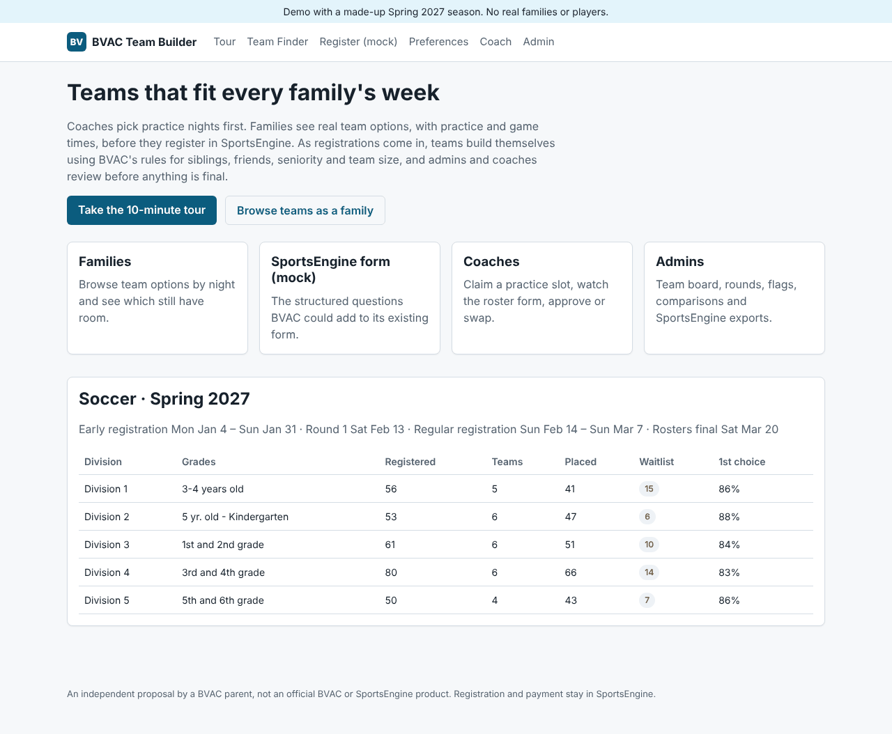 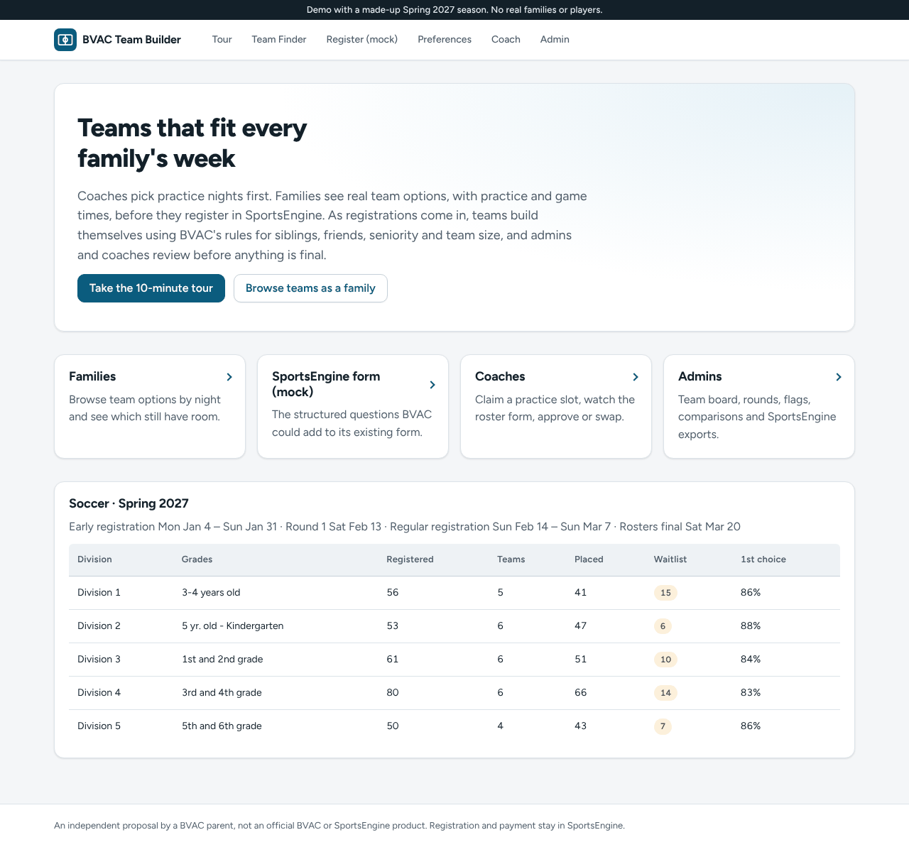

### Team Finder (Division 3)

| | Before | After |
| --- | --- | --- |
| Desktop, light | [before](before/finder-d3-desktop-light.png) | [after](after/finder-d3-desktop-light.png) |
| Desktop, dark | [before](before/finder-d3-desktop-dark.png) | [after](after/finder-d3-desktop-dark.png) |
| Phone, light | [before](before/finder-d3-phone-light.png) | [after](after/finder-d3-phone-light.png) |
| Phone, dark | [before](before/finder-d3-phone-dark.png) | [after](after/finder-d3-phone-dark.png) |

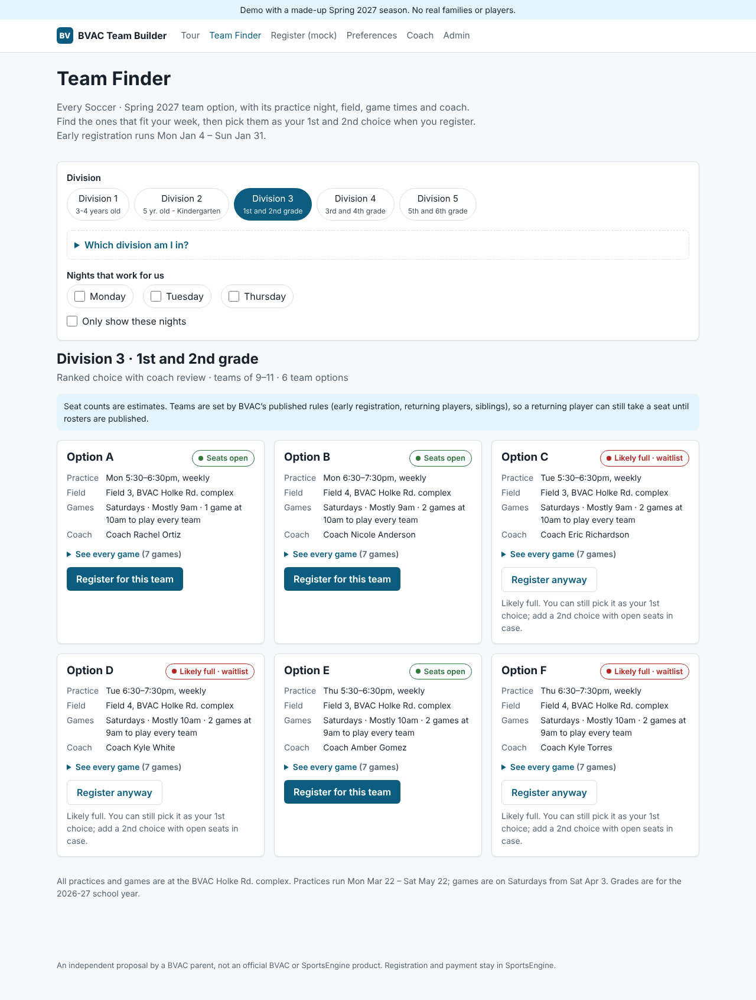 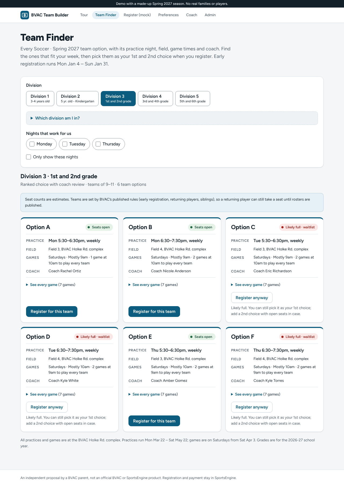

### Registration, step 3: soccer questions

| | Before | After |
| --- | --- | --- |
| Desktop, light | [before](before/register-step3-desktop-light.png) | [after](after/register-step3-desktop-light.png) |
| Desktop, dark | [before](before/register-step3-desktop-dark.png) | [after](after/register-step3-desktop-dark.png) |
| Phone, light | [before](before/register-step3-phone-light.png) | [after](after/register-step3-phone-light.png) |
| Phone, dark | [before](before/register-step3-phone-dark.png) | [after](after/register-step3-phone-dark.png) |

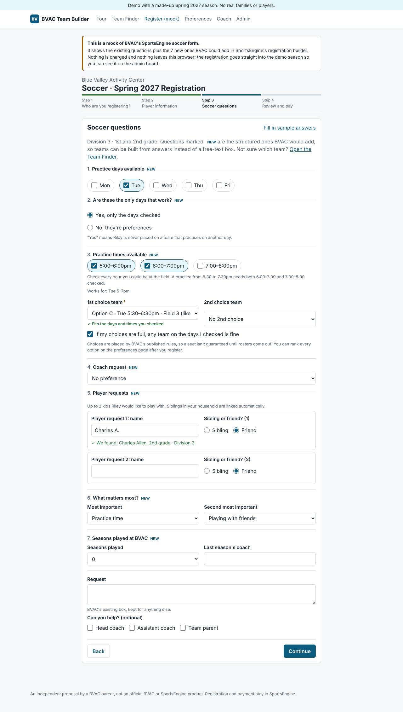 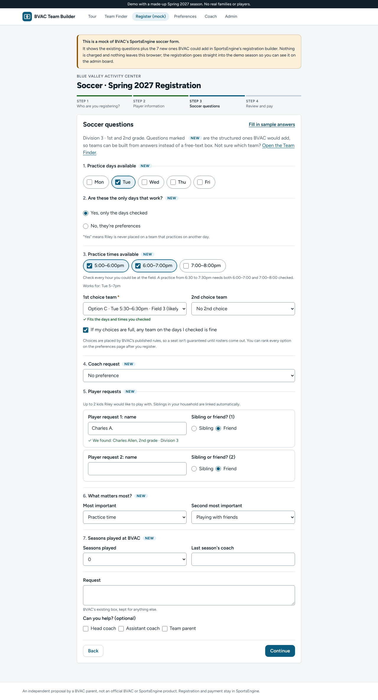

### Registration, step 4: review and pay

| | Before | After |
| --- | --- | --- |
| Desktop, light | [before](before/register-step4-desktop-light.png) | [after](after/register-step4-desktop-light.png) |
| Desktop, dark | [before](before/register-step4-desktop-dark.png) | [after](after/register-step4-desktop-dark.png) |
| Phone, light | [before](before/register-step4-phone-light.png) | [after](after/register-step4-phone-light.png) |
| Phone, dark | [before](before/register-step4-phone-dark.png) | [after](after/register-step4-phone-dark.png) |

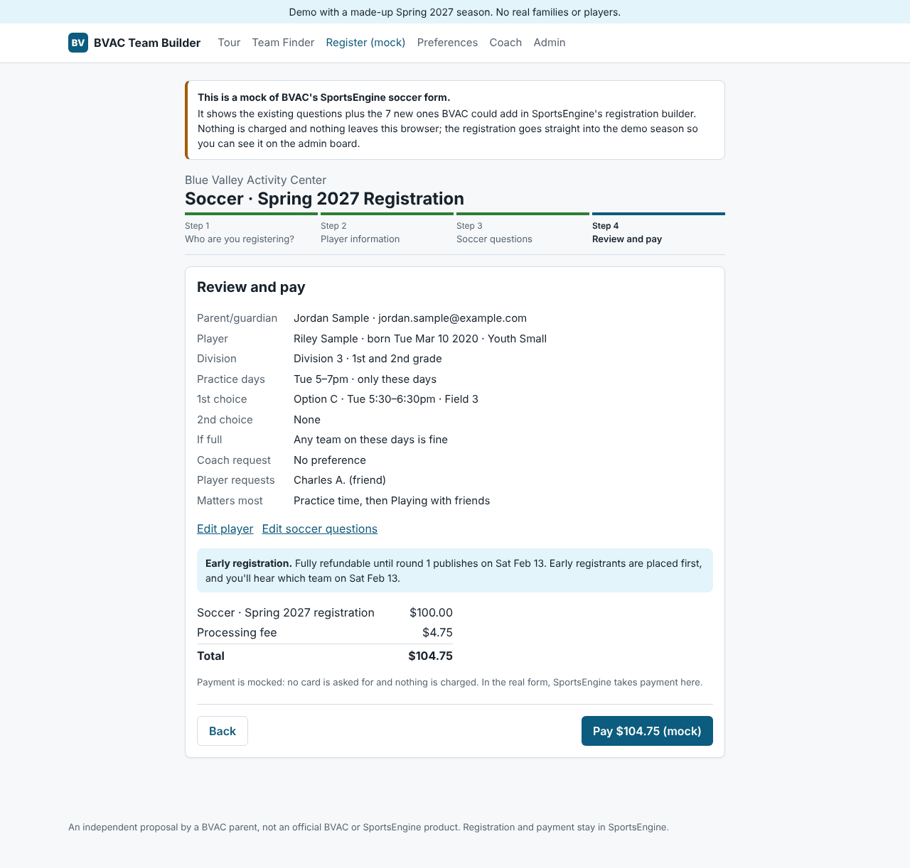 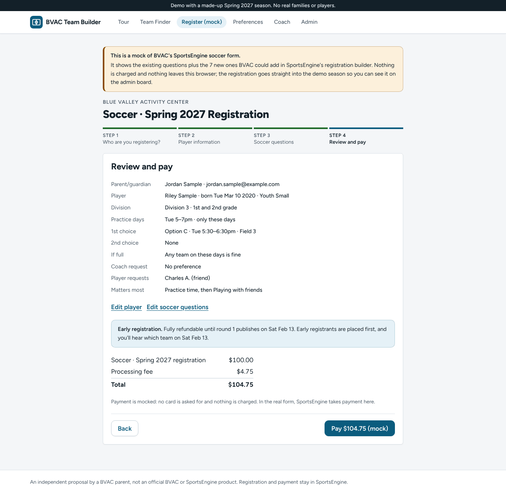

### Registration receipt

| | Before | After |
| --- | --- | --- |
| Desktop, light | [before](before/register-receipt-desktop-light.png) | [after](after/register-receipt-desktop-light.png) |
| Desktop, dark | [before](before/register-receipt-desktop-dark.png) | [after](after/register-receipt-desktop-dark.png) |
| Phone, light | [before](before/register-receipt-phone-light.png) | [after](after/register-receipt-phone-light.png) |
| Phone, dark | [before](before/register-receipt-phone-dark.png) | [after](after/register-receipt-phone-dark.png) |

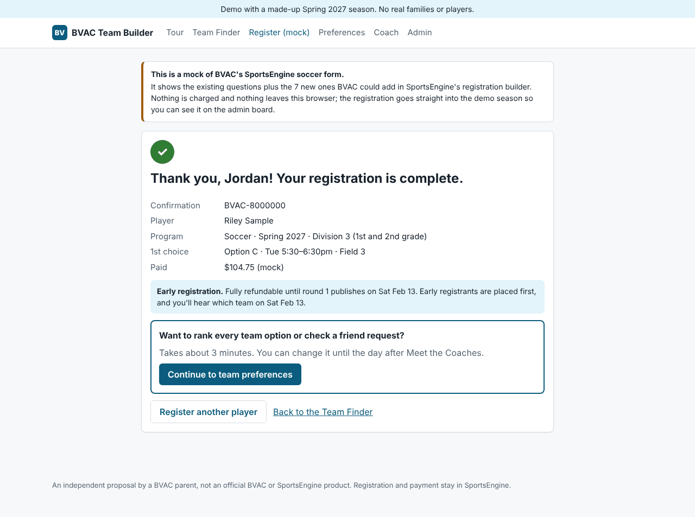 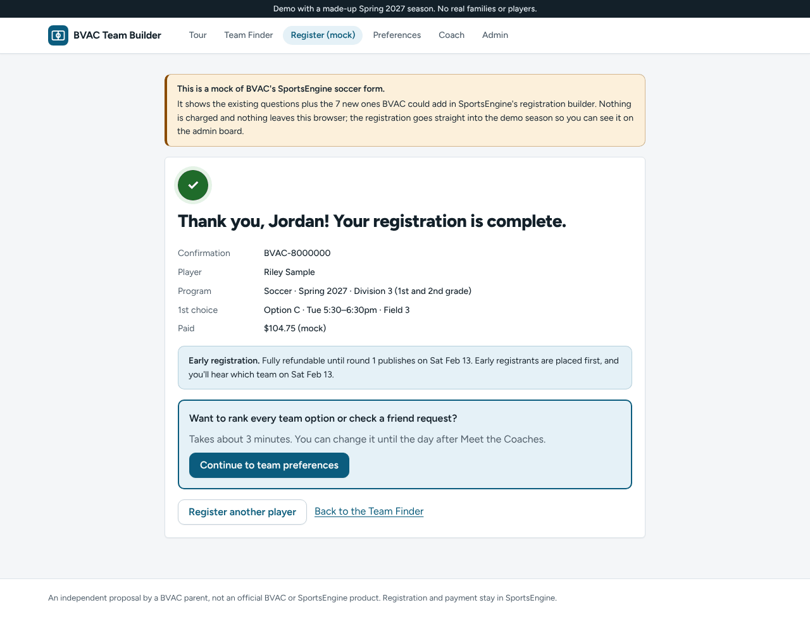

### Team preferences (from the receipt)

| | Before | After |
| --- | --- | --- |
| Desktop, light | [before](before/preferences-desktop-light.png) | [after](after/preferences-desktop-light.png) |
| Desktop, dark | [before](before/preferences-desktop-dark.png) | [after](after/preferences-desktop-dark.png) |
| Phone, light | [before](before/preferences-phone-light.png) | [after](after/preferences-phone-light.png) |
| Phone, dark | [before](before/preferences-phone-dark.png) | [after](after/preferences-phone-dark.png) |

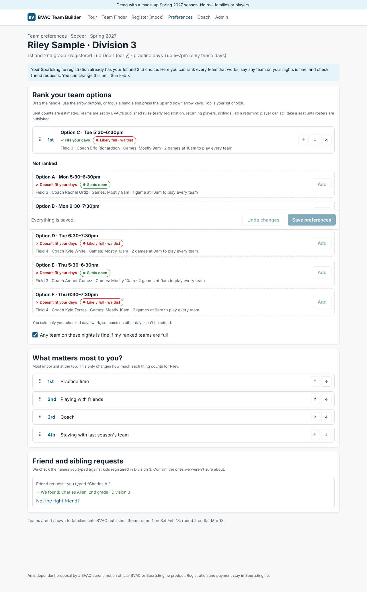 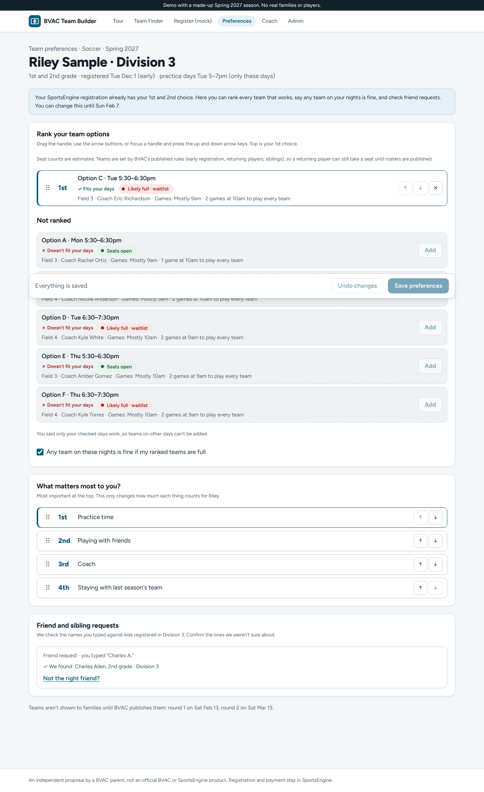

### Admin dashboard

| | Before | After |
| --- | --- | --- |
| Desktop, light | [before](before/admin-desktop-light.png) | [after](after/admin-desktop-light.png) |
| Desktop, dark | [before](before/admin-desktop-dark.png) | [after](after/admin-desktop-dark.png) |
| Phone, light | [before](before/admin-phone-light.png) | [after](after/admin-phone-light.png) |
| Phone, dark | [before](before/admin-phone-dark.png) | [after](after/admin-phone-dark.png) |

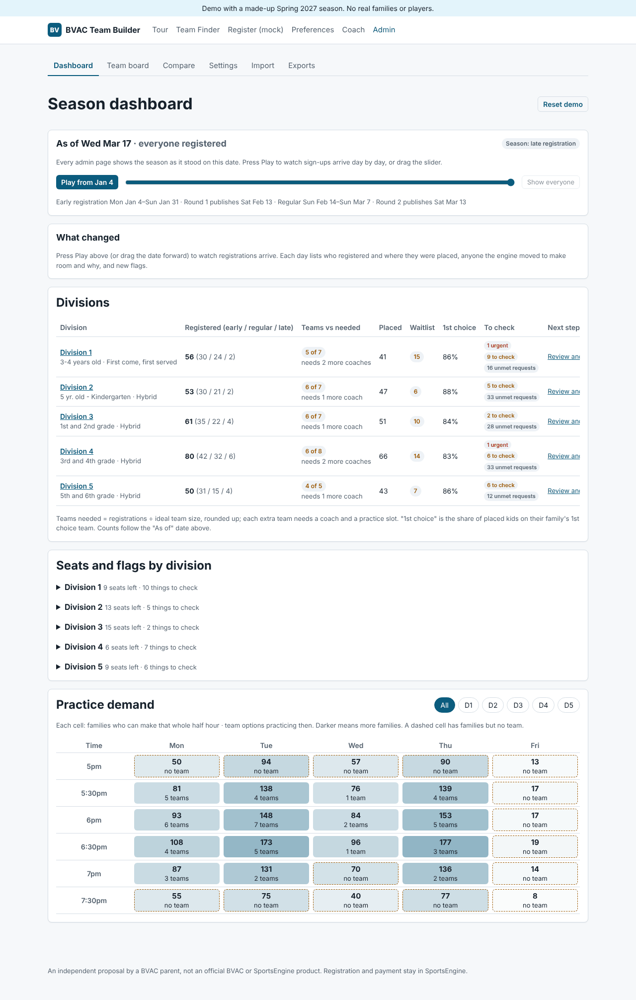 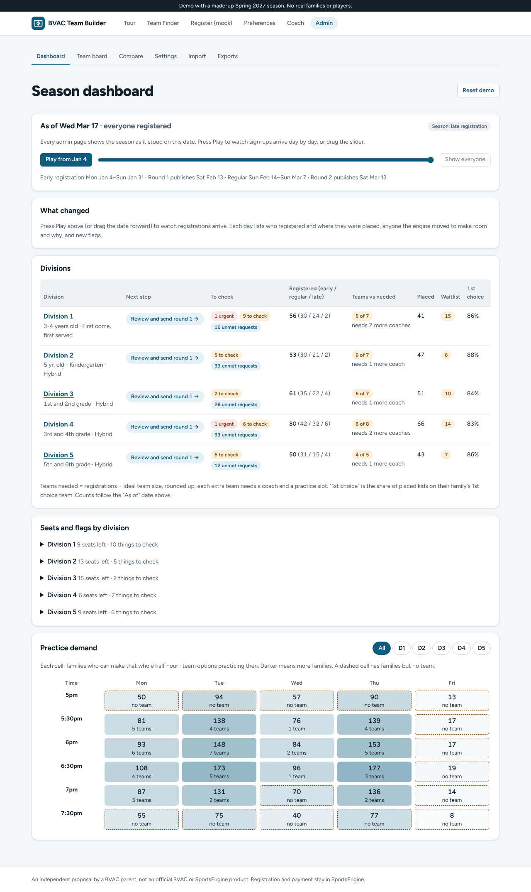

### Team board after "Send round 1 to coaches"

| | Before | After |
| --- | --- | --- |
| Desktop, light | [before](before/board-sent-desktop-light.png) | [after](after/board-sent-desktop-light.png) |
| Desktop, dark | [before](before/board-sent-desktop-dark.png) | [after](after/board-sent-desktop-dark.png) |
| Phone, light | [before](before/board-sent-phone-light.png) | [after](after/board-sent-phone-light.png) |
| Phone, dark | [before](before/board-sent-phone-dark.png) | [after](after/board-sent-phone-dark.png) |

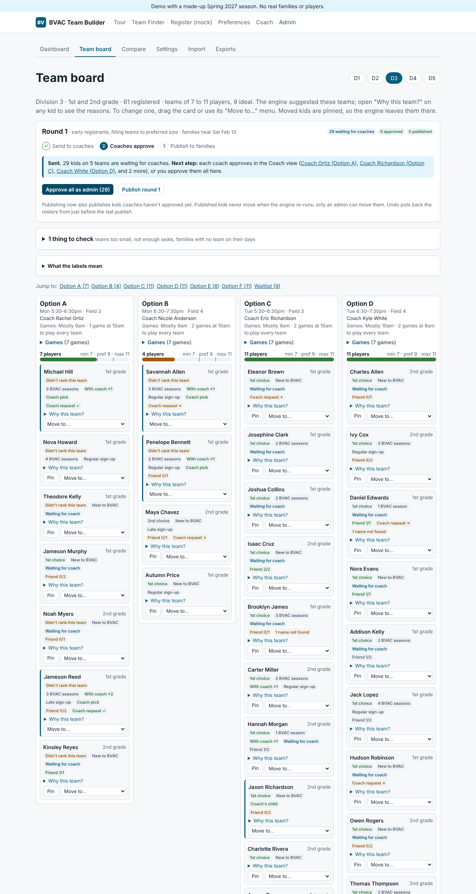 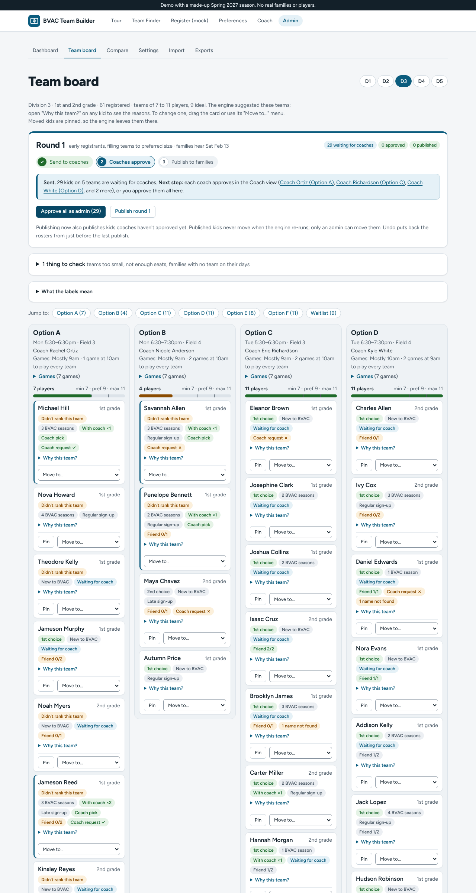

### Coach view with players to approve

| | Before | After |
| --- | --- | --- |
| Desktop, light | [before](before/coach-approve-desktop-light.png) | [after](after/coach-approve-desktop-light.png) |
| Desktop, dark | [before](before/coach-approve-desktop-dark.png) | [after](after/coach-approve-desktop-dark.png) |
| Phone, light | [before](before/coach-approve-phone-light.png) | [after](after/coach-approve-phone-light.png) |
| Phone, dark | [before](before/coach-approve-phone-dark.png) | [after](after/coach-approve-phone-dark.png) |

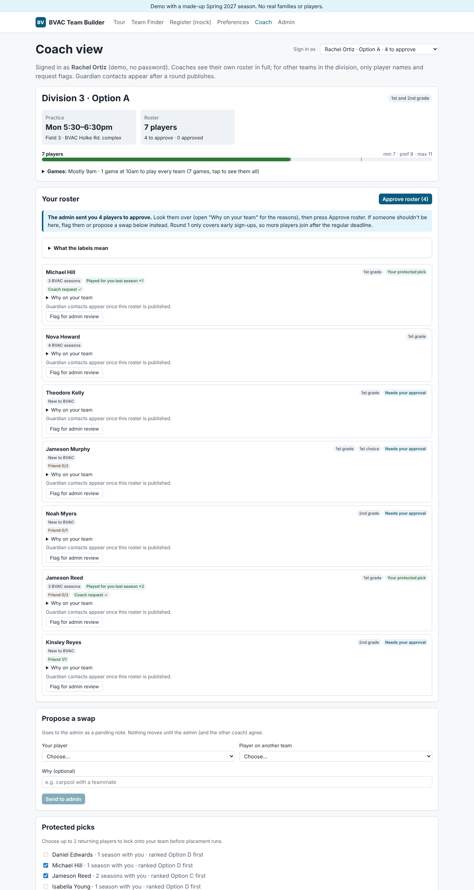 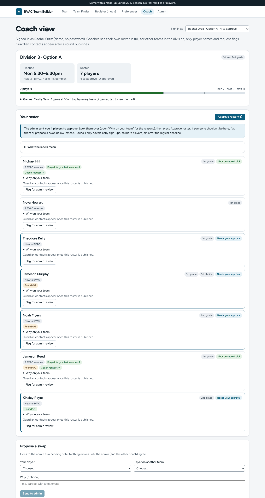
